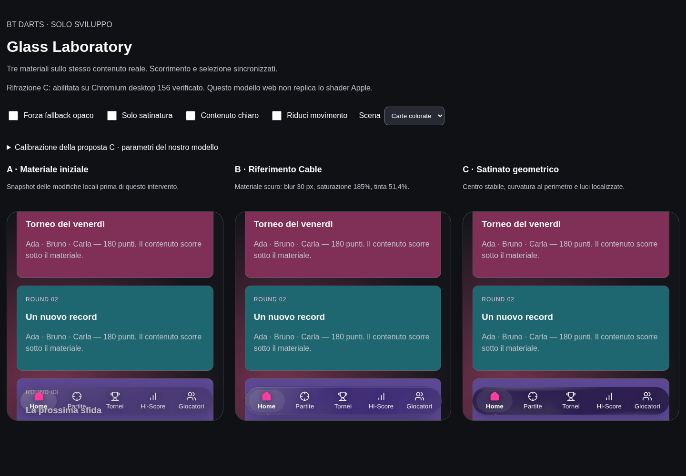
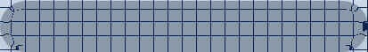
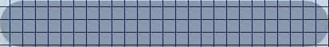
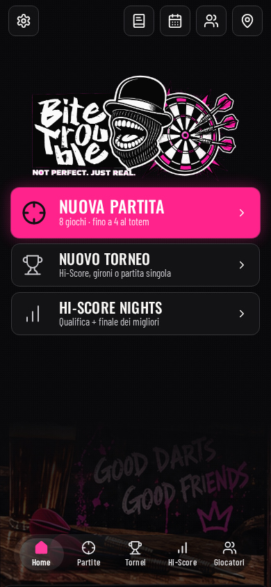

# Navbar: materiale satinato e rifrazione geometrica

> Report storico della prima implementazione. Per la successiva correzione di
> trasparenza e selezione vedere [Navbar refinement](../navbar-refinement/README.md).

Intervento locale del 28 ottobre 2026 sul branch `feat/canvas-v1.5-views`.
Nessun merge o deploy. Questo documento descrive la versione corrente; il report
`../liquid-glass-v3/README.md` resta una registrazione storica, non la descrizione del nuovo materiale.

## Audit e risultato

All'avvio erano già modificati `BottomNavigation.tsx`, `bottom-navigation.css`,
`tokens.css` e `base.css`. Conservati gli inset di 20 px, l'altezza di 58 px, la
safe area con 6 px aggiuntivi e lo scrim già alleggerito (alpha 0 → 0,08 → 0,30).
Nessun `AGENTS.md` applicabile trovato nel repository o nei suoi antenati.
La copia A del laboratorio conserva il materiale di queste modifiche locali,
non una vecchia revisione Git. Nessuna modifica a destinazioni, ownership delle
sezioni, persistenza o gestione della tastiera.

Il materiale C usa il contenuto reale della pagina: CSS backdrop per satinatura,
un unico displacement SVG opzionale e due riflessi radiali localizzati. La
selezione è un riempimento al 7,5%, senza ombra, filtro o secondo anello.
Testo, icone, badge e hit area non passano nel displacement. Il tocco modifica
soltanto la tinta e la luce locale; la piccola deformazione della tinta è limitata
allo 0,8% orizzontale / 1,2% verticale. Non ci sono animazioni decorative continue.

L'effetto è ispirato alle priorità di Liquid Glass Regular per navigazione e
leggibilità, non replica lo shader Apple. La compressione luminosa e la tinta sono
fisse: non fanno l'adattamento semantico automatico del materiale nativo.

## Parametri scelti

| Proprietà           | Valore                        | Significato nel nostro modello                                  |
| ------------------- | ----------------------------- | --------------------------------------------------------------- |
| Blur                | 16 px CSS                     | Satinatura del backdrop reale                                   |
| Tinta               | RGB 18,18,22; alpha 0,46      | Separata dal blur; mantiene leggibili le etichette chiare       |
| Saturazione         | 160%                          | Conserva variazioni cromatiche del contenuto                    |
| Luminanza           | `brightness(0.7)`             | Compressione fissa per contenuti chiari                         |
| Zona curva          | 12 px CSS                     | Fascia interna al perimetro della capsula                       |
| Spostamento massimo | 5 px CSS                      | Picco lungo la normale alla forma; `feDisplacementMap scale=10` |
| Riflessi            | alpha 0,22 / 0,099            | Ellissi sfumate in alto a sinistra e in basso a destra          |
| Ombra               | `0 7px 22px -7px`, alpha 0,28 | Separazione morbida, senza anelli                               |
| Fallback opaco      | RGB 16,16,19; alpha 0,96      | Assenza di backdrop-filter o preferenze di accessibilità        |

Sono parametri locali, non misure Apple. I 30 px / 185% di Cable rimangono nel
confronto B, insieme alla sua tinta scura di alpha 0,514 (`--tint: .45`).
Il confronto Cable riprende il materiale, non tutta l'applicazione o i suoi layout.

## Geometria e compositing

`components/glass-map.ts` calcola distanza firmata e normale di un rettangolo
arrotondato della dimensione effettiva della barra. La curvatura ha profilo
`sin²(π × profondità / fascia)`: è zero al perimetro, zero oltre la fascia e ha un
picco all'interno. R e G codificano gli spostamenti x/y. Il centro è neutro;
nessun rumore casuale, aberrazione RGB separata o animazione della mappa.

Un piccolo canvas genera esclusivamente questa mappa numerica, senza leggere i
pixel del DOM. `ResizeObserver` rigenera la mappa quando variano dimensioni; il
raggio della capsula deriva dall'altezza. La calibrazione della fascia la rigenera
una volta per modifica. Lo spostamento massimo modifica solo l'attributo SVG.
Nessun renderer WebGL/WebGPU, copia della pagina, screenshot runtime o nuova dipendenza.
Gli ID dei filtri sono unici per superficie, anche nella barra delle partite guidate.

L'audit visivo ha trovato un problema reale nel layer discendente isolato: i valori
CSS erano corretti ma il backdrop non veniva campionato. La versione finale applica
`backdrop-filter` alla capsula che costituisce lo stacking context, con clipping
tramite il suo `border-radius`. `backdrop-filter` modifica ciò che sta dietro,
non il contenuto dei link. Tinta, riflessi e selezione sono dipinti sopra.
Il filtro SVG non è in `filter` e nessun antenato nuovo introduce opacity, mask o
filter. Lo stacking esistente della shell e lo scrim a 9 / navbar a 10 restano.

La rifrazione è abilitata solo per Chromium desktop major **156**, effettivamente
verificato, oltre al controllo sintattico. Android/iOS, Edge/Opera e altri major
conservano il CSS satinato. Il gate non è una prova runtime sui pixel: per estenderlo
occorre rieseguire il confronto raster nel nuovo browser. `CSS.supports()` da solo
non abilita la lente. Safari/iOS mantiene `-webkit-backdrop-filter` e il fallback
CSS, senza URL SVG. L'opaco è la base anche quando `@supports` non si applica.

## Laboratorio e confronti

Avviare `npm run dev --prefix apps/web -- --port 5173`, poi aprire
<http://127.0.0.1:5173/glass-lab.html>. Entrypoint DEV separato e assente dalle build.

A: snapshot iniziale. B: Cable scuro. C: proposta integrata. I controlli influenzano
solo C e permettono di variare separatamente blur, tinta, saturazione, fascia curva,
spostamento, riflessi e ombra. Selezione e scroll sono sincronizzati. Griglia, testo,
carte colorate e fotografia locale `/assets/bt-footer.jpg` non richiedono rete.
Sono disponibili contenuto chiaro, riduzione del movimento, opaco e sola satinatura.

Per isolare la curvatura: scegliere Griglia, blur 0, tinta 0, riflessi 0 e confrontare
«Solo satinatura». Il test nasconde le etichette solo negli screenshot diagnostici.



| Griglia con rifrazione                                   | Stessa griglia senza rifrazione                                  |
| -------------------------------------------------------- | ---------------------------------------------------------------- |
|  |  |

| Home iniziale, comprese le modifiche locali | Home finale                         |
| ------------------------------------------- | ----------------------------------- |
|        |  |

Altri confronti: [testo](screenshots/comparison-text.png),
[fotografia](screenshots/comparison-photo.png), [griglia](screenshots/comparison-grid.png),
[contenuto chiaro](screenshots/comparison-light.png), [fallback opaco](screenshots/comparison-opaque.png).

## Verifica riproducibile

```sh
npm run typecheck
npm run build
npm run test:e2e --prefix apps/web -- --project=standalone standalone-navigation.spec.ts standalone-layout.spec.ts standalone-guided.spec.ts
node apps/web/scripts/glass-capture.mjs
node apps/web/scripts/glass-verify.mjs
PLAYWRIGHT_BROWSERS_PATH=/tmp/bt-glass-browsers node apps/web/scripts/glass-verify.mjs firefox
PLAYWRIGHT_BROWSERS_PATH=/tmp/bt-glass-browsers node apps/web/scripts/glass-verify.mjs webkit
```

- TypeScript root/web/worker e build standalone/shared passati.
- 9/9 test Playwright: cinque destinazioni, sottosezioni e cronologia; layout e
  target minimi 44 px; tastiera via focus touch; safe area simulata; focus visibile,
  contrasto e reduced motion; isolamento DEV; tre flussi partita guidati.
- Chromium 156.0.8078.4, headless shell Linux: prova raster positiva. La differenza
  media RGB sulla fascia curva è circa 12,43/255; al centro è 0. Il test verifica
  anche il fallback satinato senza URL, l'opaco e la sfocatura realmente rasterizzata.
- Prova di scroll su viewport 390×844: 119 intervalli misurati per variante,
  nessuna rigenerazione della mappa durante scroll/cambi tab. I JSON riportano
  tempi rAF e, in Chromium, TaskDuration/LayoutDuration/RecalcStyleDuration CDP.
  Non sono misure del tempo GPU, energia o prestazioni su telefoni. Le tre scene
  restano nel DOM con scroll sincronizzato: non usare questi numeri come classifica
  isolata dei costi dei materiali.
- Firefox 157.0 headless Linux: layout, navigazione, focus touch, selezione,
  fallback opaco, focus tastiera e preferenze all'avvio passati. Per le preferenze
  emulate è necessario ricaricare: `matchMedia` cambiava prima dell'applicazione
  delle regole CSS. **Verifica visiva del blur non superata**: non cambia il raster
  neppure una pagina minima con solo griglia e `backdrop-filter: blur(16px)`.
  Anche forzando WebRender software il risultato non cambia. Non attribuiamo
  questo risultato a tutti i Firefox reali: è un limite osservato nell'ambiente
  headless disponibile. Nessuna rifrazione SVG abilitata su Firefox; la resa
  satinata va ricontrollata in un Firefox con compositore funzionante. Il JSON
  conserva intenzionalmente l'esito negativo, senza trasformarlo in un successo.
- WebKit 27.2 scaricato ma non avviabile: mancano `libicu74` e `libjpeg-turbo8`.
  [Esito del tentativo](webkit-verification.json). Nessuna installazione di pacchetti
  di sistema effettuata. **Safari su dispositivo e browser Android reali non provati.**
- Riduzione della trasparenza usa una media query dove rilevabile; verificata
  in Chromium tramite emulazione CDP. Pressione del puntatore verificata senza
  spostamento di icone/hit area né rigenerazione della mappa. I test di
  tastiera/safe area sono simulazioni, non prove con tastiera software e notch reali.

Risultati completi: [Chromium](chromium-verification.json), [Firefox](firefox-verification.json).

## Riferimenti e compromessi

- [Apple — Meet Liquid Glass, WWDC25](https://developer.apple.com/videos/play/wwdc2025/219/):
  Regular come riferimento funzionale; materiale nella navigazione, riempimenti
  semplici per i controlli interni, leggibilità e preferenze di accessibilità.
- [Apple — Materials](https://developer.apple.com/design/human-interface-guidelines/materials):
  riferimento HIG richiesto; la pagina richiede JavaScript, i dettagli tecnici consultati
  provengono dalla trascrizione della sessione WWDC.
- [Cable — ui/index.html](https://github.com/lonelyfrank/cable/blob/main/ui/index.html):
  consultato il sorgente tramite GitHub; confronto di satinatura e trattamento cromatico.
- [WebKit — Safari 18](https://webkit.org/blog/16187/webkit-features-in-safari-18-0/):
  supporto dei filtri CSS sul backdrop, distinto dalla corretta composizione dei filtri SVG.

Il compromesso principale è privilegiare una tinta leggibile e una satinatura
coerente rispetto alla massima trasparenza. La rifrazione a 16 px di blur è delicata:
la griglia a blur zero serve a verificarne la geometria, non è il preset di produzione.
