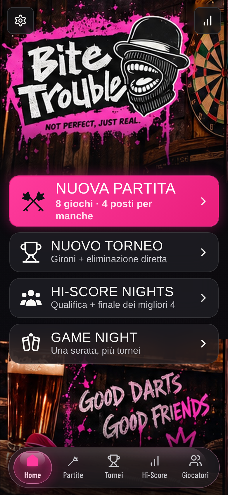
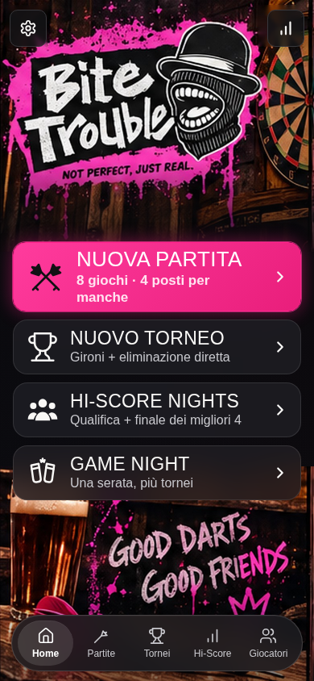
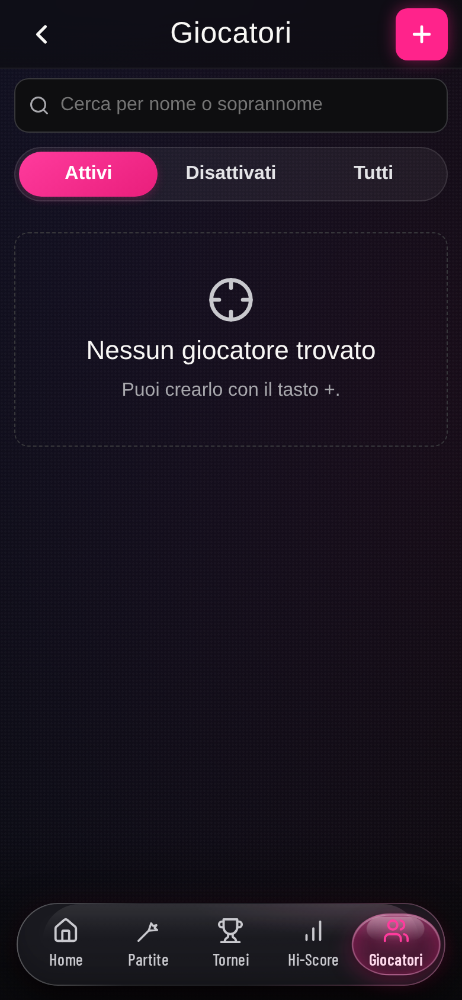
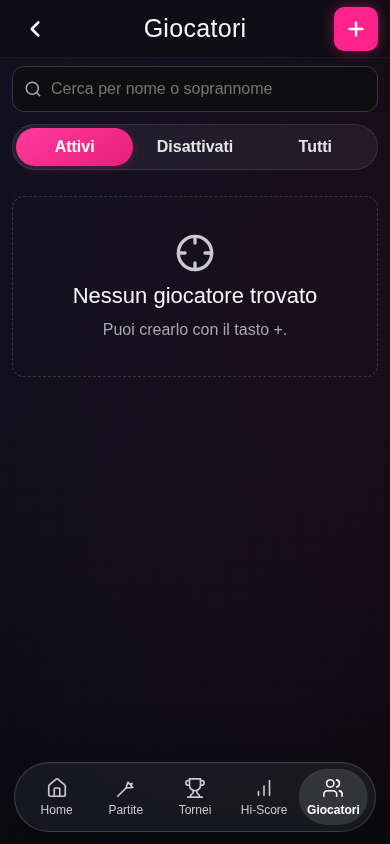
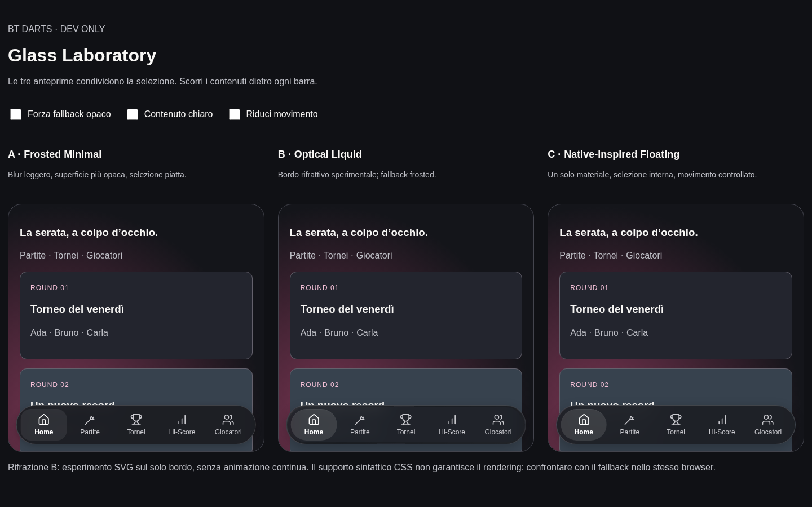
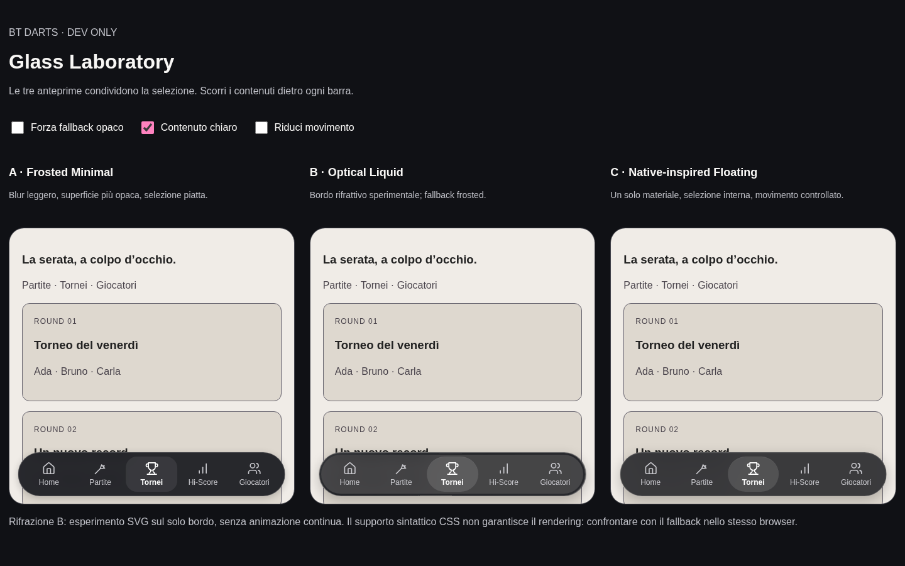
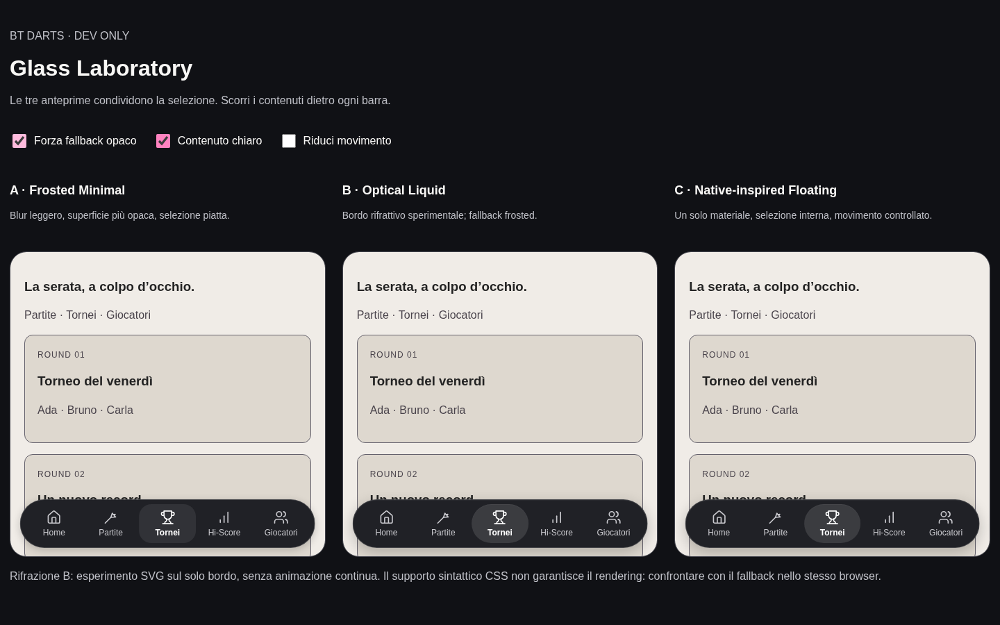

# BT Darts — Liquid Glass Navigation V3

Audit e verifica: 21 ottobre 2026. Base di confronto: commit `af78c9d`.

## Risultato

Integrata **C — Native-inspired Floating**: superficie scura neutra unica, blur di
18px, saturazione 110%, bordo sottile, una selezione interna traslucida e movimento
di 180ms senza overshoot. Le cinque icone sono lineari, monocromatiche, con stroke
uniforme di 1.8. Il rosa BT resta nel focus da tastiera e nell'identità della pagina.
Nessuna dipendenza aggiunta, nessun cambiamento ai dati o alle logiche di gioco.

## Audit iniziale

- `apps/web/src/components/ui.tsx`: conteneva `BottomNavigation`, cinque destinazioni,
  `useLocation` e `NavLink`. Un solo componente, nessuna seconda navbar React.
  Il percorso determinava la posizione di `.nav-pill`; il figlio `.nav-capsule`
  veniva rimontato al cambio tab per riprodurre lo stretch.
- `styles/app.css`: superficie con blur/saturazione, ombra esterna multipla e
  ombra interna, bordo a gradiente mascherato, riflesso superiore con due gradienti,
  capsula rosa con bordo/ombre proprie, riflesso della capsula, bolla al tocco,
  `drop-shadow` rosa sulle icone e riempimento delle icone Home/Tornei.
  Nessun filtro SVG di rifrazione: l'effetto precedente era interamente CSS.
- `styles/tokens.css`: famiglia `--bt-lg-*`, spring con controllo sopra 1,
  durata 340ms; stretch `scale(1.14, 0.93)`. La combinazione di volume rosa,
  luci su più superfici e deformazione dava la sensazione di singoli pulsanti di gel.
- Una seconda regola `.bottom-nav`, molto più in basso in `app.css`, sostituiva
  materiale e blur con `rgba(32,32,38,.72)` e `blur(28px) saturate(170%)`.
  Sovrascriveva anche lo sfondo più opaco del fallback precedente. La cascata
  rendeva i token del materiale parzialmente inefficaci.
- Stacking: `.app-shell` isolato; scrim fisso a z-index 9; barra a 10; decorazioni
  con z-index negativo e link a 1. Nessuna decorazione intercettava i tocchi,
  ma molte superfici sovrapposte oscuravano il contenuto che il blur doveva mostrare.
- Dimensioni: 70px, massimo 520px, inset 14px, distanza inferiore
  `max(12px, env(safe-area-inset-bottom))`. Spazio dei contenuti e toast derivato
  da `--bt-nav-space`. Schermate partita a schermo intero senza barra.
- Mobile/PWA: regola `pointer: coarse` + focus dei campi nasconde barra, scrim e
  toast durante l'immissione. È un'approssimazione già esistente della tastiera
  virtuale, non un rilevatore della tastiera reale. Manifest standalone e offline
  gestiti da Vite PWA/Workbox. Nessun tema chiaro applicativo: il laboratorio prova
  contenuti chiari dietro una barra coerente con il tema scuro.

## Reference: tecnica, limiti e licenze

Consultati README, licenza e sorgenti indicati. Le prestazioni riportate dagli
autori sono indicazioni, non benchmark eseguiti sulle loro librerie.

| Riferimento                                                                                                                                                                                                                                                            | Rendering e interazione                                                                                                                                                        | Compatibilità, costo e manutenzione                                                                                                                                                                                                                                                                                 |
| ---------------------------------------------------------------------------------------------------------------------------------------------------------------------------------------------------------------------------------------------------------------------- | ------------------------------------------------------------------------------------------------------------------------------------------------------------------------------ | ------------------------------------------------------------------------------------------------------------------------------------------------------------------------------------------------------------------------------------------------------------------------------------------------------------------- |
| [dev-okazawa/liquid-glass-nav](https://github.com/dev-okazawa/liquid-glass-nav) · [CSS](https://github.com/dev-okazawa/liquid-glass-nav/blob/master/style.css) · [MIT](https://github.com/dev-okazawa/liquid-glass-nav/blob/master/LICENSE)                            | Layer effect/tint/shine; blur molto basso, bordo speculare, indicatore scorrevole e bloom al tocco. Rifrazione opzionale via SVG nel backdrop.                                 | Approccio CSS/React/vanilla relativamente piccolo; utile la separazione del materiale dal contenuto. L'autore segnala problemi Safari combinando filter e backdrop-filter e problemi di backdrop root. Scartati bloom e blur animato; mantenuta l'idea del singolo materiale.                                       |
| [rdev/liquid-glass-react](https://github.com/rdev/liquid-glass-react) · [sorgente](https://github.com/rdev/liquid-glass-react/blob/master/src/index.tsx) · [MIT](https://github.com/rdev/liquid-glass-react/blob/master/LICENSE)                                       | Mappe SVG, displacement separato sui canali RGB, elasticità/pointer tracking e modalità shader opzionale. È una superficie generica, non una tab bar con semantica di routing. | README dichiara displacement parziale/assente in Safari e Firefox. Il sorgente combina filter e backdrop su un layer e discrimina Firefox. Più parametri e lavoro di compositing da mantenere; l'aberrazione e l'elasticità contraddicono l'obiettivo sobrio. Nessuna adozione.                                     |
| [aberhamm/liquid-glass-react](https://github.com/aberhamm/liquid-glass-react) · [capabilities](https://github.com/aberhamm/liquid-glass-react/blob/main/src/capabilities.ts) · [MIT con attribution](https://github.com/aberhamm/liquid-glass-react/blob/main/LICENSE) | Frosted come base; rifrazione live opzionale su Chromium; rifrazione cross-engine su una copia del contenuto. Offre anche segmented control e reduced motion.                  | Il sorgente distingue supporto sintattico CSS e compositing reale del displacement, con gate conservativo Blink. La copia della scena amplia manutenzione e costo; utili invece fallback con geometria invariata e progressive enhancement. Nessuna libreria installata.                                            |
| [dpawlikowski/liquid-glass](https://github.com/dpawlikowski/liquid-glass) · [CSS](https://github.com/dpawlikowski/liquid-glass/blob/main/src/core/liquid-glass.css) · [MIT](https://github.com/dpawlikowski/liquid-glass/blob/main/LICENSE)                            | CSS/SVG, turbulence e displacement; scena duplicata, aberrazione e caustiche/pulse opzionali. Il CSS consultato include anche enhancement di live backdrop via `@supports`.    | Il README descrive il supporto cross-browser della scena duplicata: non equivale a rifrazione del DOM vivo in tutti i browser. Turbulence animata e scene replicate hanno un costo dichiarato; struttura senza runtime dependencies ma eccessiva per questa barra. Nel lab solo un filtro statico minimo sul bordo. |
| [Apple HIG — Tab bars](https://developer.apple.com/design/human-interface-guidelines/tab-bars) e [Materials](https://developer.apple.com/design/human-interface-guidelines/materials)                                                                                  | Navigazione stabile, icone e nomi comprensibili, materiale flottante distinto dai contenuti e selezione riconoscibile.                                                         | Linee guida per componenti nativi, non una libreria CSS né garanzia di resa equivalente sul web. Nessun asset o codice Apple incorporato. Applicati i principi di gerarchia, etichette permanenti e continuità.                                                                                                     |

Le quattro licenze sono state lette: tutte MIT. Nessun codice o asset dei progetti
è stato copiato o vendorizzato; sono state riutilizzate idee tecniche generali con
implementazione locale. Non è stata aggiunta alcuna licenza di terzi al bundle.

## Glass Laboratory

Avvio: `npm run dev --prefix apps/web -- --port 5173`, poi
<http://127.0.0.1:5173/glass-lab.html>.

Entrypoint HTML separato, import protetto da `import.meta.env.DEV`; Vite produce
solo l'entrypoint applicativo `index.html`. Il laboratorio non è una route della
app e non compare nei bundle standalone/shared o nel precache. Non accede a
IndexedDB, API, companion, localStorage o service worker. Le tab delle anteprime
sono pulsanti che cambiano solo lo stato locale condiviso. La navbar di produzione
rimane un insieme di link `NavLink` con `aria-current`.

Tre anteprime affiancate su desktop, impilate su mobile, con identica geometria e
contenuti scorrevoli. Selezione sincronizzata, controlli per contenuto chiaro,
fallback opaco e movimento ridotto. La variante B prova un bordo di 3px con
displacement statico di intensità 3, senza RGB separato o animazioni continue.
È abilitato in modo conservativo solo in Blink con supporto sintattico CSS;
Safari/Firefox mantengono frosted. Il supporto CSS da solo non dimostra la corretta
rifrazione: è un esperimento visuale e non una dipendenza della soluzione finale.

| Variante                     | Esito visivo                                                                                           | Costo/compatibilità                                                     | Scelta                                                  |
| ---------------------------- | ------------------------------------------------------------------------------------------------------ | ----------------------------------------------------------------------- | ------------------------------------------------------- |
| A — Frosted Minimal          | Molto leggibile; più opaca e piatta; selezione discreta.                                               | Un blur 10px, saturazione contenuta, fallback opaco.                    | Alternativa valida, ma profondità ottica meno evidente. |
| B — Optical Liquid           | Bordo leggermente più presente; beneficio della rifrazione limitato nel contesto scuro.                | Blur 14px più un filtro del bordo; comportamento dipendente dal motore. | Solo DEV: complessità non giustificata dal confronto.   |
| C — Native-inspired Floating | Superficie continua, selezione interna chiara, icone uniformi; buon equilibrio anche su sfondo chiaro. | Un blur 18px; niente SVG, observer, pointer tracking o loop JS.         | **Integrata.**                                          |

La scelta è qualitativa e tecnica, non un test con utenti. Il piccolo benchmark
di scroll del laboratorio non dimostra che C sia più veloce di A/B: serve a
individuare stalli evidenti nel solo ambiente disponibile.

## Refactor e accessibilità

- Componente isolato in `components/BottomNavigation.tsx`, con re-export da `ui.tsx`
  per preservare gli import esistenti. Percorsi e ordine invariati. `matchPath`
  allinea la selezione alle regole di React Router, inclusi sottopercorsi,
  maiuscole e slash finale. Nessuna selezione fittizia su Impostazioni/route estranee.
- Materiale in `styles/bottom-navigation.css`, token `--bt-nav-*` in `tokens.css`.
  Rimossi vecchi `--bt-lg-*`, spring, keyframe stretch e override duplicato.
  `--bt-dur-indicator` resta invariato perché usato anche dalle schermate punteggio.
- Scrim meno scuro; safe area, ingombro, toast e comportamento dei campi conservati.
  Decorazione singola non interattiva, nessun filtro sulle icone, nessun blur animato.
- Link con target almeno 44×44px, testo sempre presente, focus rosa visibile,
  movimento disattivato con reduced motion. Sfondo opaco come base; blur aggiunto
  solo con `@supports`. Reduced transparency/contrast more ripristinano l'opaco;
  forced colors usa colori di sistema e contorno della selezione.
- Contrasto testo verificato anche su contenuti chiari nel laboratorio. Non è
  una certificazione WCAG completa dell'applicazione.
- Nessuna modifica a routing applicativo, servizi, persistenza, modalità shared,
  schermate partita o collegamenti al totem. Nessun servizio remoto aggiunto.

## Verifica e limiti

Comandi riproducibili:

```sh
npm run check
npm run format:check
npm run test:e2e
node apps/web/scripts/glass-capture.mjs
node apps/web/scripts/glass-verify.mjs
PLAYWRIGHT_BROWSERS_PATH=/tmp/bt-glass-browsers node apps/web/scripts/glass-verify.mjs firefox
```

- Typecheck root/web e build standalone/shared completati; 18 file / 220 test Vitest
  passati. Il repository non definisce uno script lint; il controllo di stile è
  Prettier. Laboratorio assente dai due output di build, verificato anche via E2E.
- Suite Playwright finale: **27/27 passati**, inclusi 4 nuovi test su link, sottopercorsi, cronologia,
  focus, reduced motion, safe-area simulata, contrasto e isolamento DEV.
  Il primo giro ha trovato una race nell'helper esistente `addPlayers`:
  `count()` osservava il campo prima dello smontaggio, `inputValue()` lo cercava
  dopo. Correzione limitata al test: lettura atomica con `evaluateAll`, stessa
  condizione di successo. Nessun timeout aumentato né modifica al flusso giocatori.
- [Chromium](chromium-verification.json) e [Firefox](firefox-verification.json):
  layout 320×568, 390×844, 844×390 e 1440×900, target/etichette, cinque route,
  focus touch, ripristino barra, selezione del laboratorio, fallback e reduced
  motion. La suite layout esistente copre anche 360, 430 e 768px, raggiungibilità
  dei controlli e schermate di gioco. Nessun errore JavaScript nei controlli.
- Il fallback senza blur è verificato eliminando nel browser le sole regole
  `@supports` che abilitano il backdrop: resta lo sfondo base opaco, a geometria
  invariata. Il toggle DEV verifica la stessa resa senza mutare CSS di produzione.
- PWA: suite esistente per avvio offline, navigazione, salvataggio e aggiornamento.
  La safe area da 34px è simulata tramite il token risolto; non equivale a un
  dispositivo iOS installato. Anche la tastiera è verificata tramite focus touch,
  senza tastiera software reale.
- WebKit scaricato ma non avviabile su Fedora: mancano `libicu74`,
  `libjpeg-turbo8`, `gstreamer1.0-libav`. **Safari iOS non verificato**.
  Chrome Android e Firefox Android su hardware reale non disponibili: Chromium
  e Firefox desktop con viewport/touch emulati non ne sostituiscono la verifica.
- Prestazioni: 120 frame di scroll/cambi tab per variante in Chromium headless,
  riportati nel JSON. Misura rAF di laboratorio, senza throttling o misure energia;
  non misura direttamente il tempo GPU né certifica 60fps su telefoni. Ridotti
  per costruzione blur (28→18px), layer decorativi, filtri e animazioni; non è stato
  eseguito un benchmark temporale V2/V3 sul medesimo dispositivo mobile.

Prima del rilascio pubblico: verifica manuale Safari iOS e Chrome Android, sia
browser sia PWA installata, tastiera aperta, rotazione e safe area reale.

## Screenshot

Stessa viewport 390×844 per prima/dopo; il prima è acquisito a DPR 2, il dopo a
scala CSS. Le immagini sono presentate alla stessa larghezza nel confronto.

| Prima                                              | Dopo                                             |
| -------------------------------------------------- | ------------------------------------------------ |
|          |          |
|  |  |







Screenshot aggiuntivi del laboratorio mobile per
[Chromium](screenshots/chromium-lab-mobile.png) e [Firefox](screenshots/firefox-lab-mobile.png).
