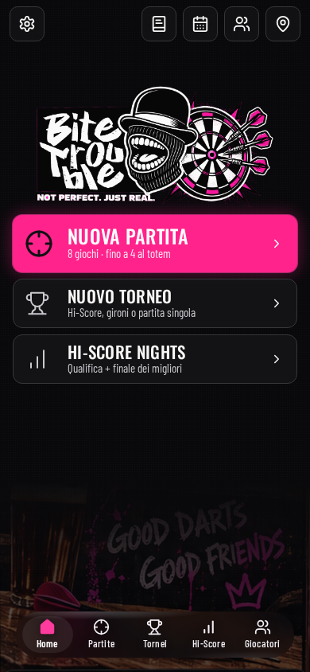
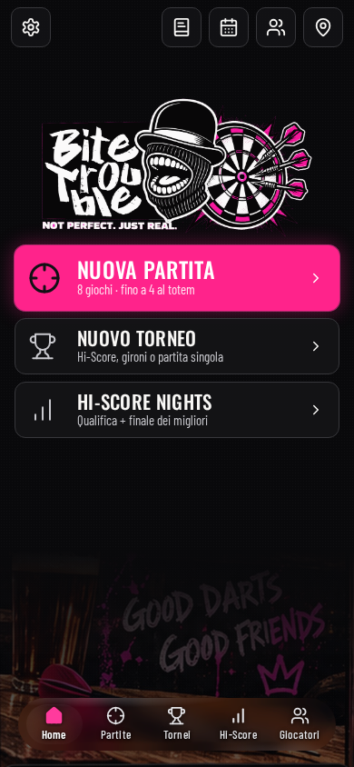
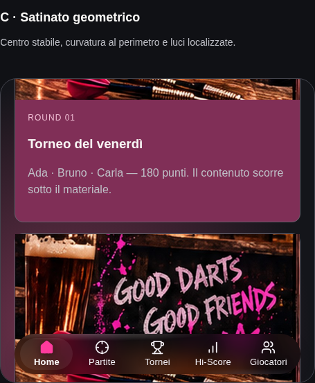
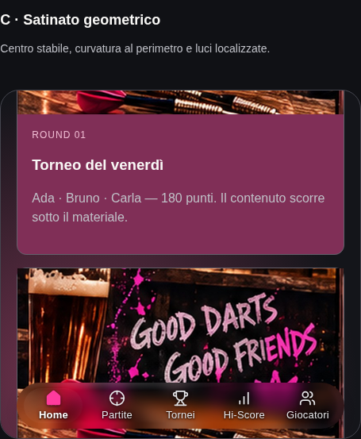

# Navbar — trasparenza e selezione integrata

Correzione locale del 28 ottobre 2026, branch `feat/canvas-v1.5-views`.
Il lavoro locale precedente è stato conservato. Nessun merge, deploy o dipendenza aggiunta.
Non era accessibile un nuovo allegato immagine: il confronto usa due acquisizioni
reali della stessa Home locale, a 390×844, DPR 1, prima e dopo questo intervento.

## Risultato e calibrazione

La tinta scura al 46%, `brightness(0.7)` e lo scrim si sommavano. Ridurre soltanto
la tinta non bastava a rendere visibile la fotografia sotto la Home.

1. Acquisite le tinte 30%, 20% e 14%, mantenendo blur 16 px e gli altri parametri
   iniziali: [30%](screenshots/calibration-tint-0.3.png),
   [20%](screenshots/calibration-tint-0.2.png), [14%](screenshots/calibration-tint-0.14.png).
2. Alla tinta 14% confrontati i blur [16 px](screenshots/calibration-blur-16.png),
   [12 px](screenshots/calibration-blur-12.png) e [10 px](screenshots/calibration-blur-10.png)
   sullo stesso contenuto fotografico.
3. Scelti 10 px / 14%, eliminata la compressione globale della luminosità e
   alleggerito lo scrim. Riflessi e ombra ridotti; selezione e pressione separate.

| Parametro               | Prima                   | Dopo                           |
| ----------------------- | ----------------------- | ------------------------------ |
| Tinta RGB 18,18,22      | alpha 0,46              | **alpha 0,14**                 |
| Blur                    | 16 px                   | **10 px**                      |
| Saturazione             | 160%                    | 150%                           |
| Luminosità del backdrop | 70%                     | **100%**                       |
| Scrim metà / fondo      | 0,08 / 0,30             | 0,025 / 0,12                   |
| Riflessi localizzati    | 0,22                    | 0,18                           |
| Ombra esterna           | alpha 0,28              | alpha 0,20                     |
| Selezione               | riempimento bianco 7,5% | gradiente neutro **5,5% → 2%** |
| Movimento selezione     | 520 ms + stretch        | **200 ms**, sola traslazione   |

I parametri sono centralizzati in `apps/web/src/styles/tokens.css`, incluse tinta,
luminosità, ombra, riflessi, scrim, geometria interna, hover, pressione, colori/pesi
delle etichette, focus e durate. Il laboratorio legge i preset dai token effettivi;
non mantiene più valori numerici duplicati che possono divergere dalla navbar.

La rifrazione geometrica precedente resta limitata al Chromium desktop 156 verificato:
fascia interna di 12 px, picco di spostamento di 5 px, centro neutro. Negli altri
browser resta il percorso CSS satinato, senza filtro SVG. Nessuna nuova distorsione.

## Selezione e interazione

- Un solo indicatore condiviso; nessuno sfondo selected sui link. La sua capsula
  interna ha margini equilibrati, tinta neutra, nessun blur, filter, ombra o bordo.
- Selected deriva dalla route, `aria-current="page"` sulla destinazione esatta,
  `aria-current="location"` sulla sezione di appartenenza. Sono gestiti anche slash
  finali e maiuscole, coerentemente col router. Nel laboratorio i pulsanti
  continuano a usare `aria-pressed`; nessun ruolo tablist.
- Icona attiva rosa, etichetta bianca a peso 600; inattive neutre a peso 500.
  La larghezza delle etichette è riservata, senza spostare il box o l'icona.
- Pressione: una sola luce temporanea locale, senza scala o deformazione. Rilascio,
  pointercancel, uscita, perdita della cattura, click, cambio destinazione,
  window blur e cambio visibilità ripuliscono lo stato. Nessun aggiornamento React
  per movimento del puntatore; la mappa non viene rigenerata.
- Hover: luce 3,5% soltanto sulle voci inattive, nei dispositivi con puntatore fine
  e hover. Non cambia l'indicatore, il peso o `aria-current`.
- Focus-visible: contorno dedicato, indipendente da selezione e hover.
- Reduced motion: transizioni disattivate. Contrasto elevato, riduzione della
  trasparenza e forced colors mantengono i fallback e il focus accessibile.

## Confronto sulla stessa Home

| Prima                                      | Dopo                                     |
| ------------------------------------------ | ---------------------------------------- |
|  |  |

La fotografia reale resta la stessa. I toni caldi attraversano ora il materiale;
Home è una zona leggermente illuminata, con una sola superficie di selezione.

| Fotografia prima                            | Fotografia dopo                           |
| ------------------------------------------- | ----------------------------------------- |
|  |  |

Altri casi: [carte colorate](screenshots/after-cards.png), [testo](screenshots/after-text.png),
[griglia](screenshots/after-grid.png), [chiaro](screenshots/after-light.png),
[fallback satinato](screenshots/after-satin.png), [opaco](screenshots/after-opaque.png).

## Verifiche e limiti

- `npm run typecheck`: root, web e worker passati.
- `npm run build`: build standalone e shared passate.
- Playwright: **8/8 test** nelle suite navigation/layout, inclusi due nuovi scenari
  per gli stati separati, gesture cancellate, focus tastiera, geometria stabile,
  navigazione rapida, route con slash finali/maiuscole e pagine appartenenti a sezioni.
- Verificati layout e target almeno 44 px, safe area simulata, comportamento del
  focus touch/tastiera e assenza del laboratorio nelle build di produzione.
- Chromium 156.0.8078.4 headless Linux: viewport mobile emulato; prove raster su
  griglia con/senza rifrazione, satinatura, fallback, pressione e preferenze di
  accessibilità. [Report dettagliato](chromium-verification.json).
- Firefox 157.0 headless Linux: layout, percorsi, pressione, focus, opaco e preferenze
  passati; **prova visiva del blur non superata**. Il filtro non modifica il raster
  neppure su una pagina minima. Il report conserva questo limite del renderer
  disponibile, senza generalizzarlo ai dispositivi reali. Le preferenze emulate
  sono provate ricaricando la pagina perché l'emulazione dinamica non aggiornava
  coerentemente le regole CSS. [Report](firefox-verification.json).
- WebKit di test: nuovo tentativo non avviabile per `libicu74` e `libjpeg-turbo8`
  mancanti. **Safari/iOS e telefoni reali non testati.** [Esito](webkit-verification.json).
- La maggiore trasparenza riduce il contrasto intrinseco su contenuti molto chiari:
  le ombre locali dei glifi aiutano la lettura, mentre il fallback opaco resta la
  modalità a contrasto elevato. Non viene dichiarato un contrasto WCAG universale
  su qualunque fotografia; non c'è analisi automatica della luminosità dei pixel DOM.

Il materiale è un modello web, non lo shader Apple. Le misure rAF/CDP riportate
sono di laboratorio, non certificazioni di fluidità o consumo su dispositivi mobili.

## Riproduzione

Con il server Vite locale sulla porta 5173:

```sh
npm run typecheck
npm run build
npm run test:e2e --prefix apps/web -- --project=standalone standalone-navigation.spec.ts standalone-layout.spec.ts
node apps/web/scripts/navbar-refinement-capture.mjs after
GLASS_REPORT_DIR=docs/navbar-refinement node apps/web/scripts/glass-verify.mjs
GLASS_REPORT_DIR=docs/navbar-refinement PLAYWRIGHT_BROWSERS_PATH=/tmp/bt-glass-browsers node apps/web/scripts/glass-verify.mjs firefox
GLASS_REPORT_DIR=docs/navbar-refinement PLAYWRIGHT_BROWSERS_PATH=/tmp/bt-glass-browsers node apps/web/scripts/glass-verify.mjs webkit
```

Non rieseguire `navbar-refinement-capture.mjs before` sulla nuova versione: quel
comando acquisisce lo stato al momento dell'esecuzione, non ricostruisce una revisione Git.
